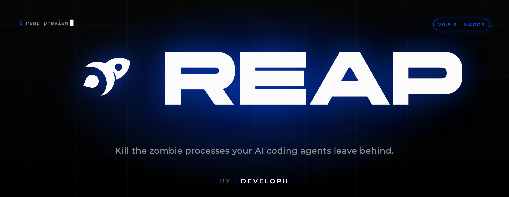
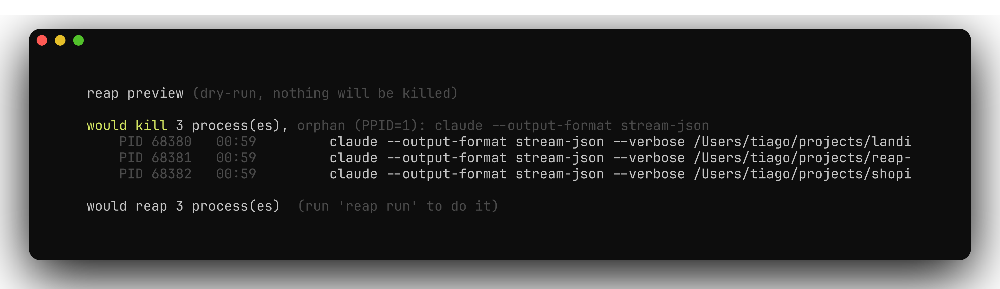
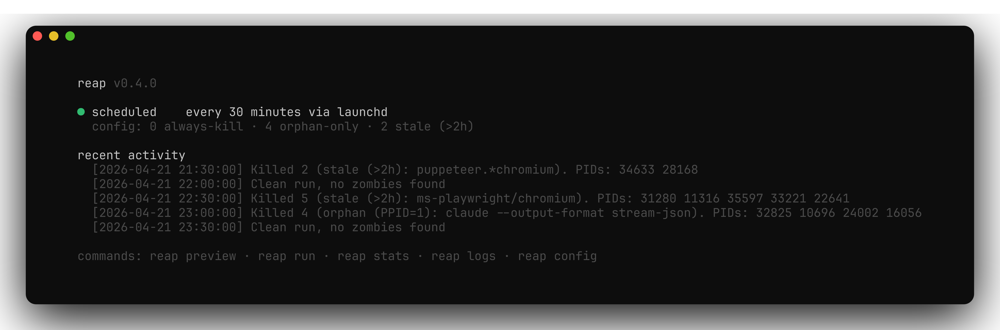
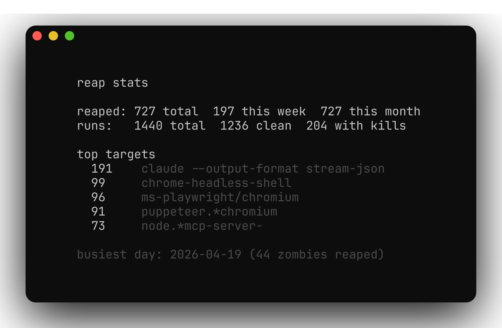

<p align="center">
  <a href="https://www.developh.co">
    
  </a>
</p>

# reap 🪦

> Kill the zombie processes your AI coding agents leave behind.

[](./LICENSE)
[]()
[](https://github.com/Developh/homebrew-tap)
[](https://github.com/Developh/reap/actions/workflows/shellcheck.yml)
[](https://skills.sh/developh/reap)

A tiny macOS tool that sweeps away abandoned Oh My Pi, `claude`, `cursor-agent`, `codex`, `aider`, Playwright, agent-browser, and MCP-server processes. Runs every 10 minutes in the background (configurable). A match is killable only after it has no live terminal owner and remains detached across repeated scans. Interactive browsers are hard-protected.

<p align="center">
  
</p>

## The problem

If you live in AI-agent IDEs (T3 Code, Claude Code, Cursor Agent, Warp Agent Mode, Codex CLI, name your poison), you've probably noticed your Mac running hot for no obvious reason. One afternoon I actually checked:

```
30   claude CLI processes (only 2 of them actually in use)
80   orphaned opencode-ai servers (I don't even use opencode)
12   MCP servers from sessions that died hours ago
4    zombie Playwright Chromiums from a test run on Monday
load average: 4.90 · fan spinning · battery melting
```

Agent wrappers spawn child processes and don't always reap them when you close a session, switch projects, or the IDE crashes. They pile up silently for days.

## The fix

A shell script, a LaunchAgent, and a small CLI. The LaunchAgent runs every 10 minutes (configurable via `REAP_INTERVAL_SEC`) and evaluates six rule tiers:

| Tier | Candidate condition | Example targets |
|---|---|---|
| `ALWAYS_KILL` | Pattern match with no active owner | Tools you never use that keep spawning |
| `ORPHAN_ONLY` | `PPID=1` | orphaned agent CLIs and MCP hosts |
| `OLD_PROCESS` | Older than N hours | Playwright, agent-browser daemons, detached MCP servers |
| `HEAVY_MEMORY` | RSS > N MB (opt-in) | detached agent or renderer leaks |
| `HIGH_CPU` | Sustained %CPU > N over two samples (opt-in) | detached providers stuck in loops |
| `DEDUPE` | Older duplicate beyond the N newest (opt-in) | leaked MCP-server clones |

Every tier then passes through the same ownership classifier. A process is protected if it belongs to a live terminal tree, is an interactive browser, has a live agent-browser child, matches the system/shell blocklist, or is still inside the detached-candidate quarantine. Resource thresholds alone are never treated as proof that a process is abandoned.

Detached candidates are persisted in `~/.local/share/agent-reaper/detached-candidates.tsv`. They must remain detached across scheduled scans for `DETACHED_GRACE_MINUTES` before termination. If a candidate becomes active or stops matching, its observation state is discarded.

Termination uses `SIGTERM`, waits `TERM_GRACE_SEC`, and escalates only surviving processes to `SIGKILL`.

## Install

### Homebrew (recommended)

```bash
brew install developh/tap/reap
reap install
```

`brew install` puts the `reap` CLI on your `$PATH`. `reap install` then builds the `.app` bundle, schedules the LaunchAgent, and runs an initial sweep.

### curl

```bash
curl -fsSL https://raw.githubusercontent.com/Developh/reap/main/install.sh | bash
```

### From source

```bash
git clone https://github.com/Developh/reap.git
cd reap
./install.sh
```

The installer always:
- places the `reap` CLI somewhere on `$PATH` (Homebrew's `bin/`, or `~/.local/bin/` for the other two modes)
- builds `~/Applications/Agent Reaper.app` (a proper ad-hoc signed macOS bundle, so Login Items and Activity Monitor show **Agent Reaper**, not a nameless `bash`)
- loads the LaunchAgent, which fires an initial sweep immediately

### As an agent skill

```bash
npx skills add developh/reap
```

Teaches Claude Code, Codex, Cursor and other agents to diagnose a hot Mac with `reap preview` and clean up with `reap run` instead of `pkill`. The skill does not install `reap` itself; it tells the agent how to, and to ask you first.

## Status at a glance

`reap` on its own shows you what's scheduled, what rules are active, and the last few runs:

<p align="center">
  
</p>

| Command | What it does |
|---|---|
| `reap` | Status: schedule, config summary, recent activity |
| `reap preview` | Dry-run grouped by rule. Explains kill-ready, quarantined, and protected PIDs. Kills nothing. |
| `reap top` | Kill-ready candidates sorted by RSS; protected and quarantined matches are explained. |
| `reap run` | Classify matches, advance quarantine state, and terminate kill-ready processes. Also what the LaunchAgent calls. |
| `reap disk [run]` | Idle agent worktrees: preview what would go to the Trash, or clean now. Off until `WORKTREE_ROOTS` is set. |
| `reap doctor` | Full health check: scheduler loaded, app bundle intact, config sane, last run recent. |
| `reap stats` | Historical totals: this week, this month, top targets, busiest day. |
| `reap logs [-f]` | Show recent log entries. Pass `-f` to follow. |
| `reap config` | Open `~/.config/agent-reaper/config.sh` in `$EDITOR` |
| `reap install` | (Re)install the LaunchAgent and the app bundle |
| `reap uninstall` | Remove it. Add `--purge` to also delete config and logs. |

## Preview before you reap

Check both the candidates and the reasons matches are being spared:

```
$ reap preview
reap preview (dry-run, nothing will be killed)
  protected   PID 81434  owned by live terminal ttys000
  protected   PID 45937  interactive browser; calls, tabs, and screen sharing are protected
  quarantine  PID 91587  new detached candidate; requires 15m continuous observation

no kill-ready processes  1 quarantined · 2 protected
```

## Stats

After a couple of weeks of running you can ask `reap` what it's been up to:

<p align="center">
  
</p>

Totals are derived from the log file, so they're accurate even across reinstalls (the log is preserved by default on uninstall).

## Customize

```bash
reap config
```

…opens `~/.config/agent-reaper/config.sh` in your `$EDITOR`. Move patterns between tiers, add your own, adjust the stale threshold:

```bash
ALWAYS_KILL=(
    "opencode-ai/bin/.opencode"     # I don't use opencode
)

ORPHAN_ONLY=(
    "claude --output-format stream-json"
    "cursor-agent.*stream"
    "codex.*--output-format"
    "aider.*--stream"
    "bun .*/\\.bun/bin/omp"                 # Oh My Pi
    "__omp_worker_"                         # OMP eval/browser workers
    "node.*mcp-server-"                       # MCP servers (3rd party)
    "node.*@modelcontextprotocol/server-"     # MCP servers (official)
    "my-custom-agent --daemon"                # your own
)

OLD_PROCESS=(
    "ms-playwright/chromium"
    "puppeteer.*chromium"
    "chrome-headless-shell"
    "agent-browser/bin/agent-browser-"
    "bun .*/\\.bun/bin/omp"
    "__omp_worker_"
)
OLD_THRESHOLD_HOURS=2

# Opt-in: consider detached matching processes whose RSS exceeds the threshold.
# Live terminal trees and interactive browsers remain protected.
HEAVY_MEMORY=(
    # "node.*opencode"
    # "bun .*/\\.bun/bin/omp"
    # "__omp_worker_"
    # "electron.*--renderer"
)
HEAVY_MEMORY_MB=2000

# Opt-in: consider detached matching processes whose sustained %CPU
# (averaged over two samples) exceeds the threshold.
HIGH_CPU=(
    # "/.local/bin/agent"
    # "/cursor-agent/.*/rg"
    # "node.*opencode.*serve"
    # "bun .*/\\.bun/bin/omp"
    # "__omp_worker_"
)
HIGH_CPU_PCT=85
HIGH_CPU_SAMPLE_SEC=20

# Opt-in: keep only the N newest instances of each pattern, kill older
# duplicates. Built for MCP-server hoarding — every closed agent session
# tends to leak its MCP clients.
DEDUPE=(
    # "mcp-remote"                       # any mcp-remote-fetched MCP
    # "shadcn mcp"
    # "@modelcontextprotocol/server-"
    # "node.*mcp-server-"
)
DEDUPE_KEEP=3

# Long-lived hosts (no TTY) whose children leak while the host lives on.
# Per host, keep the 20 newest children of each command; reap older surplus.
HOSTS=(
    "codex app-server"
    "claude --output-format stream-json"
)
HOST_CHILDREN_KEEP=20
HOST_CHILDREN_MIN_AGE_MIN=15

# Notify above this much swap; tighten the HOSTS tier above the critical mark.
SWAP_ALERT_MB=8192
SWAP_CRITICAL_MB=12288

# Opt-in disk cleanup: idle agent worktrees lose their dependency folders
# (to the Trash) once a day. See "Disk" below.
WORKTREE_ROOTS=(
    "$HOME/.t3/worktrees"
    "$HOME"/code/*/.claude/worktrees
)
WORKTREE_IDLE_DAYS=3
WORKTREE_DEPENDENCY_DIRS=(node_modules .next)

# Require repeated detached observations before termination.
DETACHED_GRACE_MINUTES=15

# Graceful shutdown window before SIGKILL fallback.
TERM_GRACE_SEC=3
```

## Disk

Agent wrappers (T3 Code, the Codex app, Claude Code under `.claude/worktrees`) create a git worktree per thread or subagent and leave it behind when the thread ends. Each one has its own `node_modules` and build cache. On a Next.js app that is about 1.6 GB per worktree; one machine reached 73 GB.

Set `WORKTREE_ROOTS` and, once a day, the regular sweep moves `node_modules` and `.next` of idle worktrees to the Trash:

```
$ reap disk
worktrees (dry-run, nothing will be moved; idle > 3d, dirs: node_modules .next)
  keep        ~/.t3/worktrees/app/t3-8cb34e5c  uncommitted changes
  keep        ~/.t3/worktrees/app/t3-e2a9ea4d  git activity in the last 3d
  trash       ~/.t3/worktrees/app/t3-1f0c9a22  1.6 GB
would move 1.6 GB from 1 worktree(s) to the Trash
```

A worktree is only touched when it is a linked worktree (main checkouts are skipped), `git status` is clean, git has seen no activity for `WORKTREE_IDLE_DAYS`, and no process runs inside it. Code, commits and branches stay. Nothing is deleted: the folders go to the Trash, and an install brings them back. `reap disk run` cleans now; `reap stats` shows the total moved.

## Safety

Hardcoded defenses. Not configurable. They apply to every rule tier:

- **Never runs as root.** Exits immediately if invoked with `EUID=0`.
- **UID-scoped.** Only processes owned by the invoking user are considered.
- **Live owner protection.** A PID is protected when it or any living ancestor owns a TTY, or when a living ancestor is one of the `HOSTS` (GUI wrappers such as T3 Code run agents without a TTY). Active sessions therefore protect their MCPs, workers, and automation browsers. Leaks under a live host are capped by the `HOSTS` tier instead.
- **Interactive browser blocklist.** Chrome, Safari, Firefox, Brave, Edge, Arc, and Dia app processes are never killed. Google Meet, screen sharing, tabs, and renderer spikes stay untouched.
- **Repeated detached observations.** A new detached match enters quarantine instead of being killed. It must remain detached for `DETACHED_GRACE_MINUTES` across scheduled scans.
- **Active agent-browser sessions.** Daemons with live browser children are protected.
- **System and shell blocklist.** Reap refuses to kill `launchd`, `kernel_task`, `WindowServer`, login shells, system services, or itself.
- **Pattern sanity and max-kill cap.** Unsafe patterns are rejected; a rule matching more than 50 PIDs is aborted.
- **Graceful termination.** `SIGTERM` comes first. `SIGKILL` is only a bounded fallback.
- **Explainable dry-run.** `reap preview` states why each matching PID is kill-ready, quarantined, or protected.

## How it works

**Ownership, not resource usage.** PPID, parent chains, and TTY ownership distinguish active terminal work from detached process trees. CPU, RSS, age, and duplication decide which detached processes deserve inspection; they never override live ownership or the interactive-browser blocklist.

**Persistent quarantine.** A detached candidate signature and first-seen time survive between LaunchAgent sweeps. Reattachment or a non-match clears the record. This avoids killing a process during the transition between an active session and a genuinely abandoned tree.

**LaunchAgent, not cron.** macOS deprecated cron. `launchd` respects laptop sleep/wake, handles missed runs on resume, and doesn't need a login shell.

**A real .app bundle.** The LaunchAgent invokes `~/Applications/Agent Reaper.app/Contents/MacOS/AgentReaper` rather than a raw shell script. macOS reads the bundle's `Info.plist` to attribute the process, so Login Items, Activity Monitor, and the security pane show **Agent Reaper** with a proper identity. The bundle is ad-hoc signed at install time (`codesign -fs -`). Background-only, so no Dock icon and no app-switcher entry.

**Performance.** Base sweeps run with `Nice=10` and `LowPriorityIO=true`. The opt-in CPU tier deliberately waits `HIGH_CPU_SAMPLE_SEC` for its second sample.

## Uninstall

```bash
reap uninstall              # keep config + logs
reap uninstall --purge      # remove everything
```

## FAQ

**Will this kill my active OMP, Claude Code, Cursor, or Codex session?**
No. A live terminal anywhere in the PID's ancestor chain protects the complete tree, including MCP servers and automation browsers.

**Will it kill Chrome during Google Meet?**
No. Interactive browser app processes and helpers are hard-blocked from every tier, regardless of CPU or memory usage.

**What about leaked MCP servers whose wrapper is still alive?**
Detached MCP patterns can be caught by the stale and dedupe tiers. Active MCPs inherit a live terminal owner and are protected; detached matches must also survive the quarantine window.

**What if I actually use something in `ALWAYS_KILL`?**
Live terminal ownership and the hard blocklists still protect it. Remove the pattern if you do not want detached copies cleaned.

**Does this work on Linux?**
Not yet. The scheduler and process inspection are currently macOS-specific. Linux support via `systemd --user` is tracked in [issue #1](https://github.com/Developh/reap/issues/1).

**Is this safe? I'm paranoid.**
Run `reap preview`. It kills nothing and prints the classifier's decision for every matching PID.

## Roadmap

- [x] v0.3 `.app` bundle for macOS identity (Login Items show *Agent Reaper*)
- [x] v0.4 `reap stats`, MCP server patterns, Playwright coverage
- [x] v0.4.1 Homebrew tap: `brew install developh/tap/reap`
- [x] v0.5 `HEAVY_MEMORY` tier, `reap top`, `reap doctor`
- [x] v0.6 `HIGH_CPU` tier (sustained-CPU detection for background runaways)
- [x] v0.7 `DEDUPE` tier (kill duplicate MCP clones from closed agent sessions)
- [x] v0.8 Default sweep interval lowered 30 min → 10 min, configurable via `REAP_INTERVAL_SEC`
- [x] v0.9 Live-terminal ownership, interactive-browser protection, detached quarantine, and graceful termination
- [x] v0.10 `HOSTS` tier for children leaked under live GUI hosts, swap memory guard with notifications
- [x] v0.11 `reap disk`: opt-in cleanup of dependency folders in idle agent worktrees
- [x] v0.12 Moved to [Developh/reap](https://github.com/Developh/reap), formula renamed to `reap`, agent skill (`npx skills add developh/reap`)
- [ ] GitHub Actions release automation (tag → tap bump)
- [ ] Linux support via `systemd --user` ([#1](https://github.com/Developh/reap/issues/1))
- [ ] Patterns for more agent CLIs (Gemini, Replit Agent, etc.)

## Contributing

PRs and issues welcome. Especially if you run into an AI-agent CLI that leaks and isn't covered by the default patterns, open an issue with the `ps` output and I'll add it.

## License

MIT. See [LICENSE](./LICENSE).

## Credits

Built by [Tiago Rodrigues](https://github.com/tiagonrodrigues) ([@tiagoatdeveloph](https://twitter.com/tiagoatdeveloph)), co-founder of [Developh](https://www.developh.co), a design and development studio in Lisbon, out of frustration, after watching his Mac's fan try to achieve liftoff.

---

<p align="center">
  <a href="https://www.developh.co">
    
  </a>
  <br>
  <sub>A <a href="https://www.developh.co">Developh</a> project. Built different.</sub>
</p>
